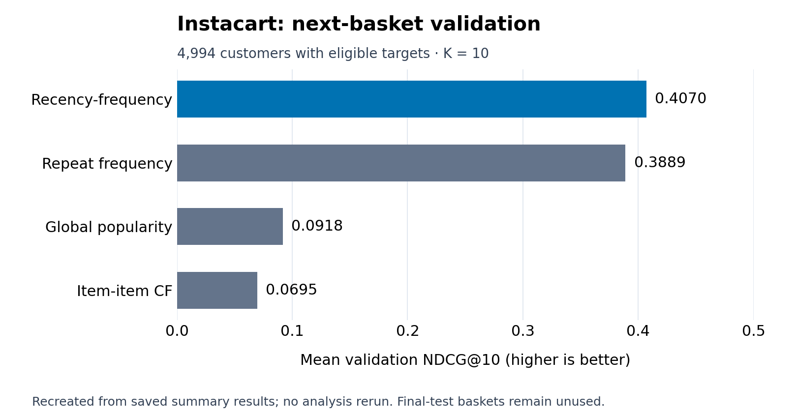

# Instacart next-basket recommendations

[Notebook with saved outputs](analysis.ipynb) · [Portfolio](../../README.md) · [Provenance](../../PROVENANCE.md)

## Question and study scope

Can purchase history support useful next-basket reminders, and can related products add discovery? This individual coursework project is a **validation study**, using five course-supplied tables: `aisles.csv`, `departments.csv`, `order_products.csv`, `orders.csv`, and `products.csv`. The exact upstream dataset release and course sampling procedure are not documented in the supplied package.

The saved main split contains **5,000 customers**, **33,230 fitting orders**, **328,487 fitting product rows**, and **24,367 candidate products**. The target baskets contain 50,638 item occurrences, including 1,270 products absent from fitting history (counted as occurrences across baskets).

## Design and metrics

For each customer, the latest order labeled `prior` is the validation basket; earlier orders form the fitting history. Customers must have at least three fitting orders. Orders labeled `train` are reserved final-test baskets and remain unused. This is a within-customer time ordering, not a single calendar-date holdout.

A candidate product must appear somewhere in the fitting history. It can be new to a particular customer, but products unseen anywhere in fitting cannot be recommended.

| Metric | Definition and averaging population |
|---|---|
| Precision@K | Hits divided by K, including empty recommendation slots as misses. Averaged over customers with eligible targets. |
| Eligible-basket recall@K | Hits divided by the number of target products in the candidate catalog. |
| F1@K | Harmonic mean of each customer's precision and eligible recall, then averaged across customers. |
| NDCG@K | Ranking quality that rewards hits near the top, normalized against an ideal list for the eligible basket. |
| Full-basket recall@K (`end_recall`) | Hits divided by the entire target basket, including products outside the candidate catalog. Averaged over all 5,000 customers. |

Six customers have no eligible target products. Their ranking metrics are undefined and excluded, leaving **4,994 customers** for precision, eligible recall, F1, and NDCG. Their full-basket recall is zero, so all **5,000** remain in that average. These are customer averages; the repeat/discovery hit rates below instead pool item occurrences.

## Methods and selection

- **Global popularity:** rank products by the number of different fitting-history customers who bought them; use the same list for everyone.
- **Repeat frequency:** rank a customer's previously purchased products by purchase count.
- **Recency-frequency:** rank by `frequency × exp(−lambda × orders_since_last)`. The existing grid search selects **lambda=0.25** using validation NDCG@10; 0.30 is nearly tied.
- **Item-item collaborative filtering:** use Jaccard overlap of fitting-history customer sets, requiring at least five shared purchasers and retaining up to 25 neighbors per product. Weight neighbors using the same frequency/recency rule. These fixed settings were not optimized.

## Saved main validation results



*Figure recreated for this portfolio from the notebook's saved four-method comparison. No analysis was rerun; no uncertainty intervals are depicted.*

| Model | Precision@10 | Eligible recall@10 | F1@10 | NDCG@10 | Full-basket recall@10 |
|---|---:|---:|---:|---:|---:|
| Global popularity | 0.0668 | 0.0685 | 0.0602 | 0.0918 | 0.0676 |
| Repeat frequency | 0.2594 | 0.3359 | 0.2518 | 0.3889 | 0.3295 |
| Recency-frequency | 0.2719 | 0.3530 | 0.2645 | 0.4070 | 0.3464 |
| Item-item CF | 0.0589 | 0.0602 | 0.0526 | 0.0695 | 0.0592 |

The paired bootstrap resamples customer-level score differences with replacement (2,000 draws; seed 446), using the 2.5th and 97.5th percentiles. Recency-frequency's NDCG advantage over repeat frequency is **0.0181**, with a saved **95% interval of 0.0157–0.0205**, above the course practical margin of 0.01. These are conditional validation comparisons: the same validation data selected lambda, so the intervals do not account for model-selection uncertainty.

## Sensitivity and discovery

The notebook checks K=5/10/15/20, nearby recency weights, short-list filling, history length, product popularity, and an earlier target basket. Recency-frequency leads the three baselines on the four ranking metrics at every tested K. At K=10, filling short lists changes its NDCG from 0.4070 to 0.4075.

The earlier-basket check rebuilds fitting histories one order earlier and keeps lambda fixed. It retains 4,116 customers. On the matched customer set, recency-frequency NDCG is **0.4149** for main validation and **0.4144** for earlier validation. The main full-sample value, **0.4070**, uses a different population. This sensitivity check is not an independent final test: lambda was selected using the later validation period.

Repeat purchases are products previously bought by the customer; discovery products are known in the fitting catalog but new to that customer. Recency-frequency recovers **50.76%** of repeat-purchase item occurrences and **0%** of discovery occurrences. The tested item-item model recovers **3.88%** of eligible discovery occurrences but substantially reduces overall ranking quality. Its NDCG difference from recency-frequency is **−0.3375** (saved 95% interval **−0.3455 to −0.3296**). This supports retaining the simpler restocking baseline for this study, not rejecting every collaborative-filtering method.

## Limitations and future work

The sample and candidate rule constrain generalization. Personalized repeat rules cannot discover new-to-customer products, and no method can recommend products absent from fitting. Reusing validation customers for selection and comparison limits uncertainty claims. No deployment, intervention, or causal effect was evaluated.

**Future work, not completed:** obtain the exact authorized files, reproduce the existing validation study, and design a final evaluation using the reserved baskets without tuning on them. No final-test result is reported here.

## Reproduce

The exact CSV files were unavailable in the accessible local folders checked; this portfolio copy has not been executed end to end. See [data requirements](data/README.md). Do not substitute a public version and assume identical results.

From the repository root, on macOS/Linux:

```bash
python3 -m venv .venv
source .venv/bin/activate
python -m pip install -r projects/instacart/requirements.txt
cd projects/instacart
python -m jupyterlab analysis.ipynb
```

Place all five CSV files in `projects/instacart/data/` before opening Jupyter. The notebook's working directory must be `projects/instacart/`. Run cells from top to bottom only after checking authorization and source identity. Versions are unpinned and these setup commands are provided instructions, not a claim of successful execution.
