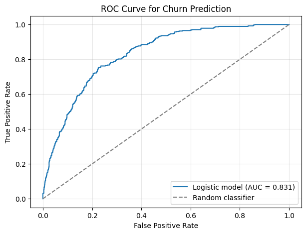

# Telco customer churn

[Notebook with saved outputs](analysis.ipynb) · [Portfolio](../../README.md) · [Authorship](../../README.md#authorship-and-ai-assistance)

## Research Question

How well do selected customer characteristics distinguish churners from customers who stay?

## Data

This BUAI 435 coursework project uses the supplied `Telco-Customer-Churn.csv`. The exact upstream release is not documented in the package. After converting `TotalCharges` to numeric and dropping missing values, the saved analysis contains **7,032 customers** and an overall churn rate of **26.58%**.

## Methods

The model is a statsmodels **binomial GLM with a logit link and intercept**. Churn is coded Yes=1 and No=0. The notebook uses a stratified 80/20 train/test split with seed 42: **5,625 training** and **1,407 test** customers. Continuous predictors are standardized using training statistics only; indicator variables stay at 0/1.

| Type | Predictors / references |
|---|---|
| Continuous | tenure, MonthlyCharges, TotalCharges |
| Indicators | Female; phone service Yes; fiber-optic internet; no internet; one-year contract; two-year contract |
| Reference categories | Male; no phone service; DSL internet; month-to-month contract |

These nine predictors precede evaluation in the notebook. The classification threshold is **0.50**, as specified by the assignment; it was not selected through a cost analysis.

### Interpreting the saved GLM estimates

These are adjusted associations with churn **log odds**, holding the other included predictors fixed. The intervals are the saved model's nonrobust 95% confidence intervals. For continuous variables, a one-unit change means **one training-set standard deviation**, not one month or one currency unit.

| Predictor / comparison | Coefficient | Saved 95% CI | Interpretation |
|---|---:|---:|---|
| Tenure, +1 training SD | −1.4175 | [−1.745, −1.090] | Longer tenure is associated with lower churn log odds. |
| Monthly charges, +1 training SD | 0.2323 | [−0.027, 0.491] | The estimate is positive, but the interval includes zero. |
| Fiber-optic internet vs DSL | 0.9965 | [0.710, 1.283] | Fiber-optic service is associated with higher churn log odds than DSL. |
| One-year vs month-to-month contract | −0.9958 | [−1.228, −0.764] | One-year contracts are associated with lower churn log odds. |
| Two-year vs month-to-month contract | −1.8568 | [−2.229, −1.485] | Two-year contracts are associated with lower churn log odds. |

These coefficients are not probability changes or relative risks. They describe conditional associations in this specification; they do not show that changing a contract or service would cause churn to change.

## Findings



*Original saved ROC curve for the 1,407-customer held-out test set.*

| Metric | Saved value |
|---|---:|
| ROC AUC | 0.831 |
| Accuracy (rounded source report) | 0.79 |
| Churn precision | 0.61 |
| Churn recall | 0.55 |
| Churn F1 | 0.58 |

At threshold 0.50:

| Actual / predicted | Stayed | Churned |
|---|---:|---:|
| Stayed | 904 | 129 |
| Churned | 169 | 205 |

The model detects **205 of 374** churners: recall is `205 / (205 + 169)`, approximately 0.55. Of **334** flagged customers, **205** actually churn: precision is `205 / (205 + 129)`, approximately 0.61. The **169 missed churners** and **129 false alarms** illustrate the trade-off between missed opportunities for outreach and unnecessary outreach. No intervention costs, recovered revenue, or actual retention benefits were measured. AUC describes discrimination across thresholds, not the success of an outreach campaign.

## Limitations

The estimates are associations, not causal effects. One random held-out split cannot establish stability across time or other populations. The saved confidence intervals depend on the fitted GLM assumptions; no robust or repeated-sampling analysis was performed. The course-specified threshold does not establish the best operational decision rule.

**Future work, not completed:** assess calibration and temporal/external stability if suitable authorized data become available. Any later threshold selection should use separate validation data rather than repeatedly tuning on this test set.

## How to Run

Place the original course CSVs in this project's `data/` directory; see [required files](data/README.md). From the repository root, create an environment using the Python 3.12 version used for execution verification:

```bash
python3.12 -m venv .venv
source .venv/bin/activate
python -m pip install -r requirements-tested.txt
python scripts/verify_analysis.py telco-churn
```

The script executes code cells through IPython without replacing notebook outputs. See [verification details](../../VERIFICATION.md) for checked results, local-log handling, and the unverified interactive Jupyter route.
